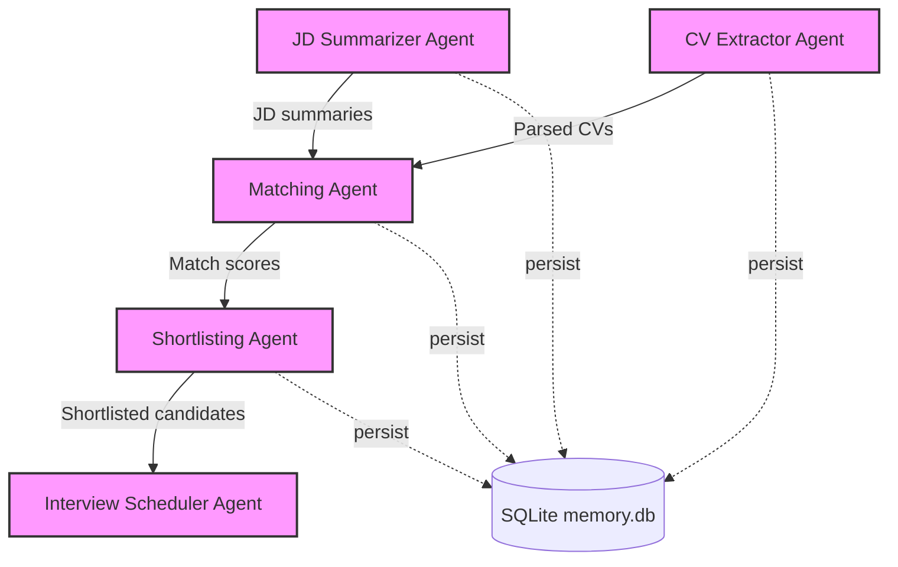

# Praxiator

**A Multi-Agent AI Recruitment Intelligence System**


## Table of Contents

- [Overview](#overview)
- [Architecture](#architecture)
- [Project Structure](#project-structure)
- [Getting Started](#getting-started)
- [Usage](#usage)
- [Configuration](#configuration)
- [Sample Results](#sample-results)
- [Database Schema](#database-schema)
- [Testing](#testing)
- [Troubleshooting](#troubleshooting)
- [Limitations & Future Work](#limitations--future-work)
- [License](#license)

## Overview

Manual resume screening is slow and inconsistent. Praxiator splits the workflow into five single-purpose agents that hand data to each other in a pipeline, with every step persisted to SQLite so runs are inspectable afterward.

| Agent | File | Responsibility |
|---|---|---|
| JD Summarizer | `agents/jd_summarizer.py` | Loads job descriptions from CSV and extracts required skills, experience, education, certifications, and responsibilities |
| CV Extractor | `agents/cv_extractor.py` | Reads PDF resumes with PyMuPDF and extracts name, email, phone, education, experience, skills, certifications, and tech stack |
| Matcher | `agents/matcher.py` | Embeds each JD and CV with `nomic-embed-text` and scores them by cosine similarity (0 to 100) |
| Shortlister | `agents/shortlister.py` | Keeps candidates at or above a configurable score threshold (default 80) |
| Interview Scheduler | `agents/emailer.py` | Generates personalized invitation emails that highlight skills matching the job, and sends them via SMTP or simulates sending |

You can drive the pipeline from the command line (`main.py`) or from a Streamlit dashboard (`app.py`).

## Architecture



**How a run works**

1. The JD Summarizer reads `job_description.csv` and produces a structured summary per role.
2. The CV Extractor parses every PDF in `resumes/`.
3. The Matcher builds a text representation of each JD and CV, embeds both through Ollama, and computes cosine similarity for every JD and CV pair.
4. The Shortlister filters each role's ranked list by the threshold.
5. The Interview Scheduler writes a personalized email per shortlisted candidate. It is simulated unless real sending is enabled (see [Configuration](#configuration)).
6. All results are stored in SQLite, and an agent diagram is generated.

## Project Structure

```
.
├── main.py                  # CLI entry point: runs the full pipeline
├── app.py                   # Streamlit dashboard
├── demo.py                  # Lightweight demo with mock processing (no Ollama needed)
├── agents/
│   ├── jd_summarizer.py     # Job description parsing
│   ├── cv_extractor.py      # PDF resume extraction
│   ├── matcher.py           # Embedding-based matching
│   ├── shortlister.py       # Threshold-based shortlisting
│   └── emailer.py           # Email generation and sending
├── utils/
│   ├── embeddings.py        # Ollama embeddings + cosine similarity
│   ├── parser.py            # Text parsing helpers
│   └── diagram.py           # Mermaid / matplotlib diagram generator
├── db/
│   └── memory.py            # Thread-safe SQLite persistence layer
├── resumes/                 # 200 synthetic sample resumes (PDF)
├── job_description.csv      # 20 sample job descriptions
├── test_db.py               # Thread-safety test for the database layer
├── test_ollama.py           # Manual smoke test for a local Ollama chat model
├── agent_diagram.md / .png  # Generated agent interaction diagrams
├── SUMMARY.md               # Project summary
└── requirements.txt
```

## Getting Started

### Prerequisites

- Python 3.10+
- [Ollama](https://ollama.ai/) installed **and running** locally

### Installation

1. Clone the repository:
   ```bash
   git clone https://github.com/Prachibagasi/Praxiator-A-Multi-Agent-AI-Recruitment-Intelligence-System.git
   cd Praxiator-A-Multi-Agent-AI-Recruitment-Intelligence-System
   ```

2. Create and activate a virtual environment:
   ```bash
   python -m venv venv
   source venv/bin/activate   # On Windows: venv\Scripts\activate
   ```

3. Install dependencies:
   ```bash
   pip install -r requirements.txt
   ```

4. Pull the embedding model:
   ```bash
   ollama pull nomic-embed-text
   ```

5. Confirm Ollama is running and the model is available:
   ```bash
   ollama list   # should list nomic-embed-text
   ```

## Usage

### Run the full pipeline (CLI)

```bash
python main.py
```

With options:

```bash
python main.py --jd-file path/to/jds.csv --resumes-dir path/to/resumes --threshold 85 --send-emails
```

| Argument | Default | Description |
|---|---|---|
| `--jd-file` | `job_description.csv` | Path to the job descriptions CSV |
| `--resumes-dir` | `resumes` | Directory containing resume PDFs |
| `--db-file` | `memory.db` | SQLite database path |
| `--threshold` | `80.0` | Minimum match score (0 to 100) for shortlisting |
| `--send-emails` | off | Run the Interview Scheduler step (see note below) |
| `--diagram-type` | `mermaid` | Diagram output: `mermaid` or `matplotlib` |

> **Note:** From the CLI, `--send-emails` currently runs in **simulation mode** and prints the emails without sending them. Real sending is available from the Streamlit **Emails** page.

### Launch the dashboard

```bash
streamlit run app.py
```

| Page | What it does |
|---|---|
| Home | Overview and one-click full pipeline run |
| Job Descriptions | Process and inspect parsed job descriptions |
| Resumes | Process and inspect extracted resume data |
| Matching | Run matching and view scores |
| Shortlisting | View shortlisted candidates (threshold slider: 50 to 100) |
| Emails | Preview, simulate, or send interview invitations |
| Database | Browse the SQLite tables |
| About | Architecture and technical details |

The sidebar lets you change the database file, JD file, resumes directory, match threshold, and whether emails are simulated.

### Try it without Ollama

`demo.py` simulates the full flow with mock processing, which is useful for a quick walkthrough:

```bash
python demo.py
```

## Configuration

Email sending is **simulated by default**. To send real emails from the dashboard, set your SMTP details as environment variables, then uncheck **Simulate emails** in the sidebar:

```bash
export SMTP_SERVER=smtp.gmail.com     # default
export SMTP_PORT=587                  # default
export SENDER_EMAIL=you@example.com
export EMAIL_PASSWORD=your-app-password
```

For Gmail, use an [app password](https://support.google.com/accounts/answer/185833), not your account password. Credentials are read from the environment only, so never commit them. The repo's `.gitignore` already excludes `.env` files.

## Sample Results

From a run over the bundled data (20 job descriptions × 200 resumes = 4,000 scored pairs):

| Metric | Value |
|---|---|
| Score range | 59.6 to 83.3 |
| Mean score | 69.5 |
| Pairs at or above the 80 threshold | 28 (0.7%) |

Embedding similarity scores cluster in a narrow band, so the threshold has a large effect on how many candidates are shortlisted. Tune `--threshold` (or the dashboard slider) to your data rather than treating 80 as meaningful on its own.

## Database Schema

Persistence lives in `db/memory.py` (SQLite, one connection per thread):

| Table | Stores |
|---|---|
| `jd_summaries` | Parsed job descriptions |
| `cv_data` | Extracted resume data |
| `match_scores` | Score for each JD and CV pair |
| `shortlist` | Shortlisted candidates and email status |

## Testing

```bash
python test_db.py       # runs 5 concurrent threads against the database layer
python test_ollama.py   # manual smoke test: needs a local chat model such as llama3
```

These are plain scripts, not a pytest suite. Contributions that add unit tests for the shortlisting logic, resume parsing, and email generation are welcome.

## Troubleshooting

**All scores are 0 and nobody is shortlisted.** Ollama is probably not running, or `nomic-embed-text` isn't pulled. When an embedding call fails, the system logs an error and falls back to a zero vector, which scores 0 against everything. Run `ollama list` and check for `Error getting embedding` in the output.

**Matching is slow.** Each JD and CV pair triggers fresh embedding calls (about 8,000 for the bundled data). Use a smaller `--resumes-dir` or a subset of JDs while experimenting.

**A resume shows `Unknown` as the name.** The name parser expects a capitalized name at the very start of the resume text. Resumes with headers or unusual layouts may not parse.

## Limitations & Future Work

- **Scores are a ranking signal, not a verdict.** Embedding similarity measures topical closeness, not qualification. Results should support human review, not replace it.
- **JD extraction is rule-based in practice.** An LLM extraction path exists in `jd_summarizer.py`, but it is not wired to a chat-capable model, so regex rules do the work.
- **No embedding cache.** Embeddings are recomputed for every pair on every run.
- **Silent embedding failures.** A failed embedding becomes a zero vector instead of raising an error.
- **Text-based PDFs only.** Scanned resumes need OCR, which isn't included.
- **Rule-based resume parsing** depends on conventional section headings.

Ideas for next steps:

- Use a chat-capable local model (for example `llama3`) for structured JD extraction
- Cache embeddings and compute each JD and CV once
- Fail loudly when Ollama is unreachable
- Add unit tests and CI
- Add DOCX resume support and OCR for scanned PDFs
- Configurable scoring weights (skills vs. experience)
- Integration with applicant tracking systems

## Data & Privacy

The bundled resumes in `resumes/` are synthetic samples. Do not commit real candidate resumes or a populated database to a public repository, since resumes contain personal data.

## License

Released under the MIT License.

## Author

**Prachi Bagasi** · [@Prachibagasi](https://github.com/Prachibagasi)